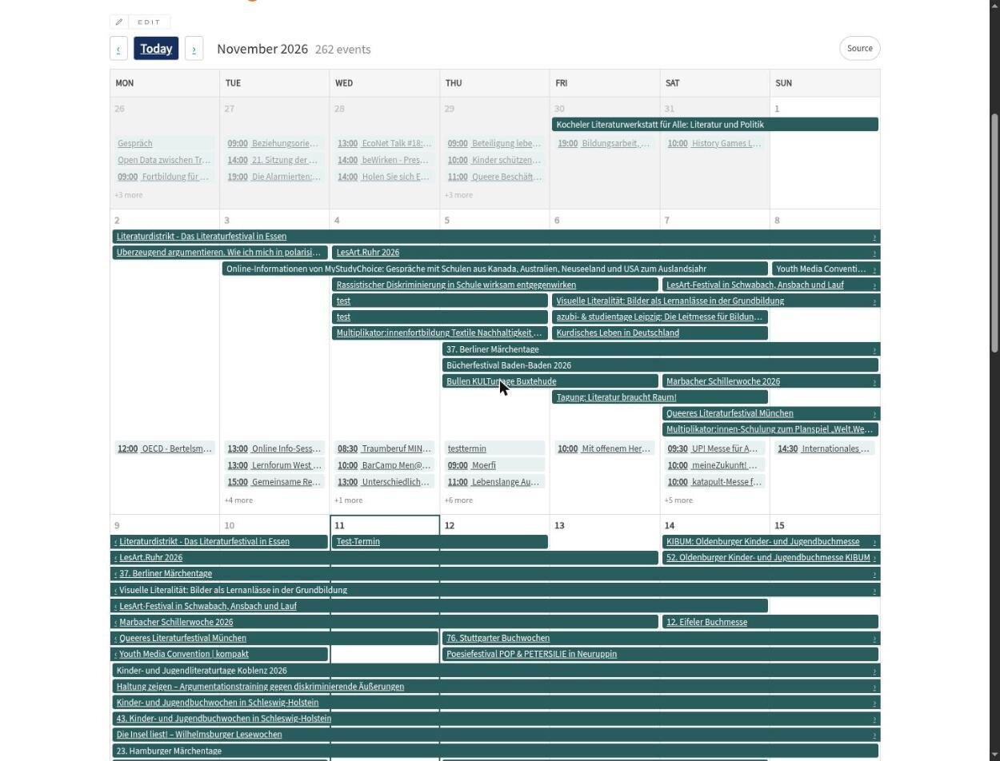
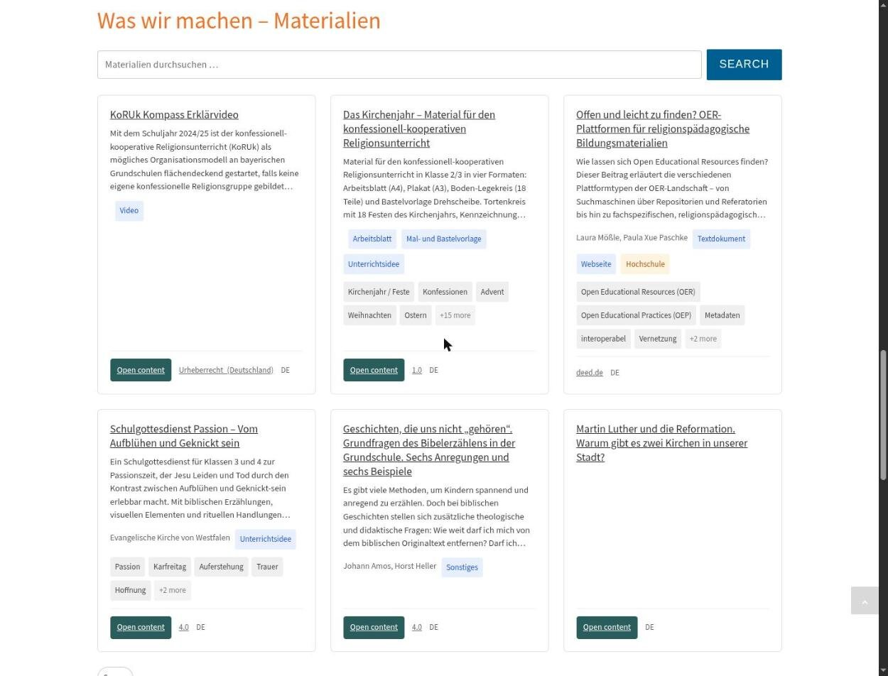
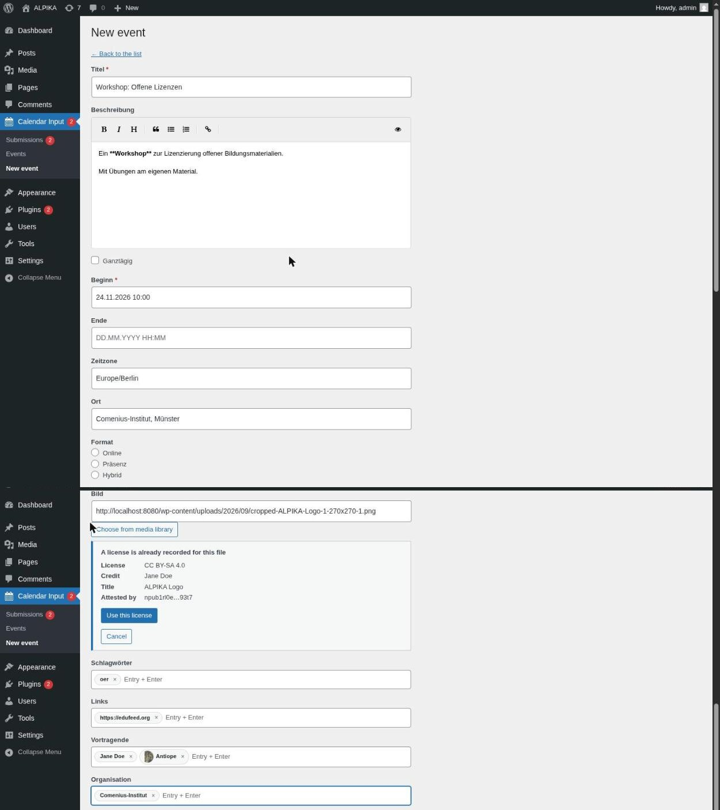

Du bist Lehrkraft, betreust die Website deiner Schule, deiner Fachschaft oder deines Vereins – oder du bloggst selbst – und möchtest dort zeigen, was in deinem Fach gerade läuft: Fortbildungen, Tagungen, Unterrichtsideen, offene Materialien. Bisher heißt das: irgendwo finden, kopieren, einfügen, drei Wochen später ist es veraltet.

Mit fünf kleinen WordPress-Plugins geht das anders. Deine Seite zeigt Veranstaltungen und Materialien aus [edufeed](https://edufeed.org) an, aktualisiert sich von selbst, und wenn du magst, können Besucher:innen dir Termine vorschlagen. Diese Anleitung ist für Menschen, die WordPress bedienen können und sonst nichts mitbringen müssen. Zeitbedarf: eine Freistunde.

## Was ist edufeed, in drei Sätzen

edufeed ist ein offenes Netzwerk für Bildungsinhalte. Veranstaltungen, Materialien und Artikel liegen nicht bei einer Firma auf einer Plattform, sondern auf vielen kleinen Servern, den *Relays*, und jede Website darf sie anzeigen. Institutionen und Fachgruppen organisieren sich dort in *Communities*; das [Comenius-Institut](https://edufeed.org/c/npub1nvw4g3twxcflygxszeemmgg22q6ue8fkhua22wpwnyfq8mjanm9s6vj992?view=calendar) zum Beispiel pflegt einen Kalender mit religionspädagogischen Veranstaltungen.

Zum Anzeigen brauchst du weder ein Konto noch ein Passwort. Deine Seite fragt die Relays einfach ab, so wie ein Feedreader einen Blog abfragt.

## Was du brauchst

- Eine WordPress-Seite ab Version 6.8, auf der du Plugins installieren darfst.
- PHP 8.2 oder neuer mit der Erweiterung `gmp`. Das ist der einzige Punkt, an dem es haken kann: Manche Hoster schalten `gmp` nicht ein. Frag im Zweifel den Support deines Hosters („Bitte PHP-Erweiterung gmp aktivieren“); ohne sie bleiben die Listen leer.
- Unter *Einstellungen → Allgemein* eine benannte Zeitzone, also „Berlin“ statt „UTC+1“. Sonst stimmen die Uhrzeiten im Sommer nicht.

## Schritt 1: Plugins installieren

Lade die Plugins von der [Release-Seite](https://git.edufeed.org/edufeed/wp-plugins-nostr/releases) herunter. Es sind fünf Zip-Dateien; du brauchst nicht alle:

| Du möchtest … | Dann brauchst du |
|---|---|
| Veranstaltungen anzeigen (Kalender, Listen) | **Nostr Calendar** |
| Unterrichtsmaterialien anzeigen und durchsuchen | **Nostr AMB** |
| Artikel aus dem Netzwerk anzeigen | **Nostr Longform** |
| Termine selbst eintragen oder von Besucher:innen vorschlagen lassen | zusätzlich **Nostr Calendar Input** |
| Eigene Blogbeiträge ins Netzwerk schicken | **Nostr Publish** |

Für den Anfang reichen **Nostr Calendar** und **Nostr AMB**.

In WordPress: *Plugins → Installieren → Plugin hochladen*, Zip auswählen, *Jetzt installieren*, *Aktivieren*. Für jedes Plugin einmal. Meldet WordPress „Die hochgeladene Datei überschreitet die upload_max_filesize-Anweisung in php.ini“, ist das Upload-Limit deines Hosters zu klein (die Zips haben 3 bis 4 MB); das lässt sich meist im Kundenmenü des Hosters auf 8 MB stellen.

Updates kommen später wie bei jedem anderen Plugin unter *Dashboard → Aktualisierungen*. Einstellen musst du nach der Installation nichts: Die Plugins kennen die richtigen Relays bereits.

## Schritt 2: Einen Kalender auf eine Seite setzen

Lege eine neue Seite an, zum Beispiel „Veranstaltungen“. Klicke im Editor auf das Plus und suche den Block **Nostr Calendar**. Füge ihn ein, fertig: Der Block zeigt die kommenden Veranstaltungen aus edufeed.

Jetzt wird es interessant, denn wahrscheinlich willst du nicht *alles*, sondern das, was zu dir passt. In der rechten Seitenleiste des Blocks gibt es dafür drei Felder:

- **Community:** Füge den Schlüssel einer Community ein, dann zeigt der Kalender deren Veranstaltungen. Den Schlüssel findest du in der Adresse der Community-Seite in edufeed; er beginnt mit `npub1…`. Für das Comenius-Institut ist das `npub1nvw4g3twxcflygxszeemmgg22q6ue8fkhua22wpwnyfq8mjanm9s6vj992`. Sobald du ihn eingefügt hast, erscheinen Name und Logo, damit du siehst, dass es die richtige ist.
- **Suche:** ein Begriff wie „Religionsunterricht“ oder „Grundschule“, dann bleiben nur Veranstaltungen übrig, in denen er vorkommt.
- **Ansicht:** Liste oder **Monatsraster**. Für eine Veranstaltungsseite ist das Monatsraster schön, mehrtägige Veranstaltungen erscheinen als Balken.

Jede Veranstaltung hat eine eigene Seite auf deiner Website, mit Zeit, Ort, Beschreibung, Referent:innen und Veranstalter. Du musst dafür nichts anlegen.

## Schritt 3: Materialien dazu

Genauso funktioniert der Block **AMB Nostr Search**: einfügen, und deine Seite hat eine Suche über offene Unterrichtsmaterialien, mit Filtern nach Fach, Schulstufe und Materialart. Auch hier kannst du in der Seitenleiste einen Suchbegriff oder eine Community vorgeben, damit auf der Seite der Fachschaft Mathematik eben Mathematik steht.

Wer gern Abkürzungen nimmt: Im Editor gibt es unter *Vorlagen* eine Kategorie **Edufeed** mit der Vorlage **Topic page (materials + events)**. Sie setzt Materialsuche und Kalender zu einem Thema auf eine Seite; du ersetzt nur noch den Platzhalter `THEMA` durch deinen Begriff.

## Optional: Termine selbst eintragen und vorschlagen lassen

Bis hierhin zeigt deine Seite an, was andere veröffentlicht haben. Mit **Nostr Calendar Input** wird sie selbst zur Quelle: Du trägst Termine ein, und Besucher:innen können welche vorschlagen, die du dann freigibst.

Dafür braucht deine Seite erstmals einen Schlüssel, denn jetzt veröffentlicht sie im Namen einer Community. Der Schlüssel heißt `nsec1…` und ist so etwas wie das Passwort der Community. Du bekommst ihn von der Person, die die Community in edufeed betreibt, zum Beispiel von eurer Institution; oder du legst in der edufeed-App selbst eine Community an, das dauert fünf Minuten und ist [hier Schritt für Schritt beschrieben](https://git.edufeed.org/edufeed/wikis/src/branch/main/articles/edufeed-create-community.md). Den Schlüssel trägst du einmal unter *Einstellungen → Nostr Calendar Input* ein. Er wird verschlüsselt gespeichert und nie wieder angezeigt. Gib ihn niemandem weiter und schreib ihn in keine E-Mail.

Danach:

- **Formular veröffentlichen** (ein Klick auf derselben Seite). Dann kannst du den Block **Suggest an event (Nostr)** auf eine Seite setzen. Besucher:innen füllen Titel, Zeit, Ort und Beschreibung aus und schicken es ab, ohne Konto.
- Unter **Kalender-Eingabe → Einreichungen** siehst du, was ankam, korrigierst bei Bedarf und klickst **Veröffentlichen**. Ab dann steht der Termin im Kalender, auf deiner Seite und überall sonst, wo diese Community angezeigt wird.
- **Neue Veranstaltung** ist dasselbe Formular für dich selbst, mit Entwürfen, Bild und Referent:innen.

Zum Datenschutz: Ein Vorschlag geht verschlüsselt an deine Seite. Name und E-Mail der einreichenden Person sieht nur die Redaktion, sie werden nie veröffentlicht, und du kannst sie jederzeit löschen. Veröffentlicht wird nur der Termin selbst.

## Optional: Eigene Beiträge ins Netzwerk

Wenn du ohnehin bloggst, kann **Nostr Publish** jeden neuen Beitrag zusätzlich als Artikel ins edufeed-Netzwerk stellen. Dann taucht er in der edufeed-App und auf anderen Seiten auf, die Artikel anzeigen. Du brauchst dafür einen eigenen Schlüssel (das Plugin erklärt, wo er hinkommt) und kreuzt unter *Einstellungen → Nostr Publish* an, dass „Beiträge“ veröffentlicht werden sollen. Der Rest passiert beim Klick auf *Veröffentlichen*.

## Wenn etwas nicht klappt

- **Die Listen bleiben leer.** Fast immer fehlt `gmp` (siehe oben), oder der Hoster blockiert ausgehende Verbindungen. Beides klärt der Support des Hosters in einem Satz.
- **Statt Namen stehen kryptische `npub1…`-Kürzel da.** Die Namen werden im Hintergrund nachgeladen; nach ein paar Aufrufen der Seite sind sie da.
- **Die Uhrzeiten stimmen um eine Stunde nicht.** Zeitzone auf „Berlin“ stellen (*Einstellungen → Allgemein*).

Alles andere, jedes Einstellungsfeld und jede Fehlermeldung, steht in der [ausführlichen Anleitung](https://git.edufeed.org/edufeed/wikis/src/branch/main/articles/edufeed-wordpress-plugins.md). Die Plugins sind freie Software (AGPL); Fragen und Fehler gern [dort melden](https://git.edufeed.org/edufeed/wp-plugins-nostr/issues).

Und wenn du nach dieser Freistunde eine Seite hast, auf der der nächste Fachtag ganz von allein erscheint: Sag's weiter. Jede Seite, die anzeigt, macht das Netzwerk für alle nützlicher.
